# TurtleBot3 SLAM and Navigation Demo (ROS 2 Jazzy + Gazebo Harmonic)

A simulated TurtleBot3 Waffle that builds a 2D map of its environment with **slam_toolbox**, then navigates that map autonomously with **Nav2**. Everything runs in Gazebo Harmonic and is visualised in RViz2. The repo also contains a small **C++ node** that sends a sequence of waypoints to Nav2.

> **Simulation only.** All images and videos in this repo come from Gazebo simulation, not from a physical robot. The project builds on existing open-source packages (see [Credits](#credits)). The work in this repo is the setup, the integration, the C++ waypoint client, and the documentation of the results.

## Demo

| Mapping with slam_toolbox | Navigation with Nav2 |
|---|---|
| 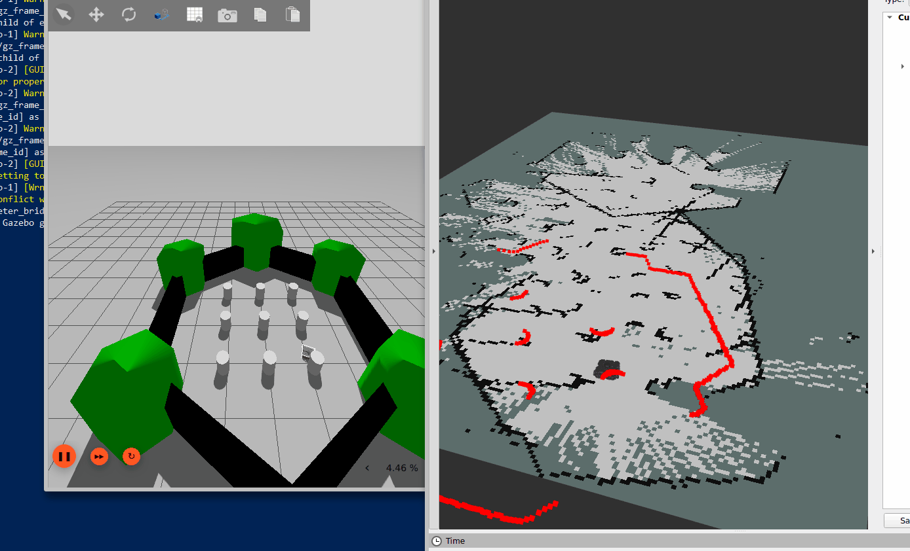 | 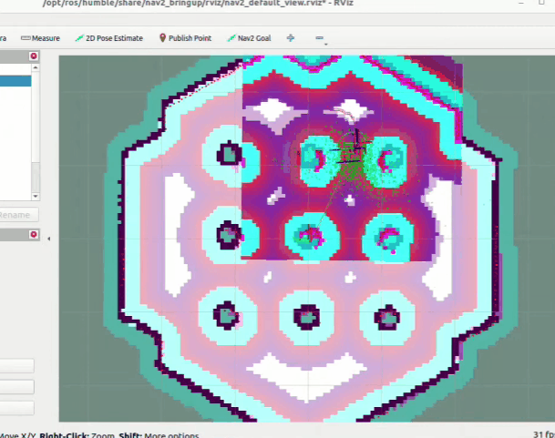 |

## Stack

| Component | Version / package |
|---|---|
| OS | Ubuntu 24.04 (WSL2 on Windows 10) |
| ROS 2 | Jazzy |
| Simulator | Gazebo Harmonic (`ros_gz`) |
| Robot | TurtleBot3 Waffle (`turtlebot3_gazebo`) |
| SLAM | `slam_toolbox` (online async mode) |
| Motion planning | Nav2 (`nav2_bringup`, `turtlebot3_navigation2`) |
| Visualisation | RViz2, `rqt_image_view` |
| Custom code | C++ (`rclcpp`, `rclcpp_action`) |

## How it works

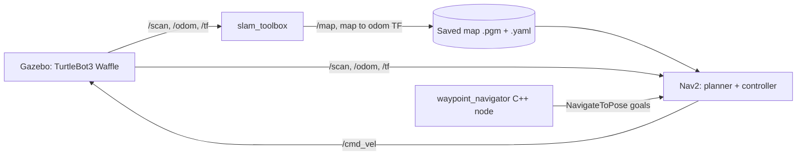

1. **Mapping:** the robot is driven by keyboard while `slam_toolbox` builds an occupancy grid from the lidar scan and odometry.
2. **Saving:** the map is saved with `nav2_map_server`.
3. **Navigation:** Nav2 loads the saved map, localises the robot (AMCL), plans a global path, and follows it with a local controller that avoids obstacles.
4. **Automation:** `waypoint_navigator` sends several goals in a row instead of clicking them one by one in RViz2.

## Simulation and sensors

The TurtleBot3 Waffle provides a lidar (`/scan`), an RGB camera (`/camera/image_raw`), an IMU, and wheel odometry (`/odom`).

| World | Robot closeup |
|---|---|
| 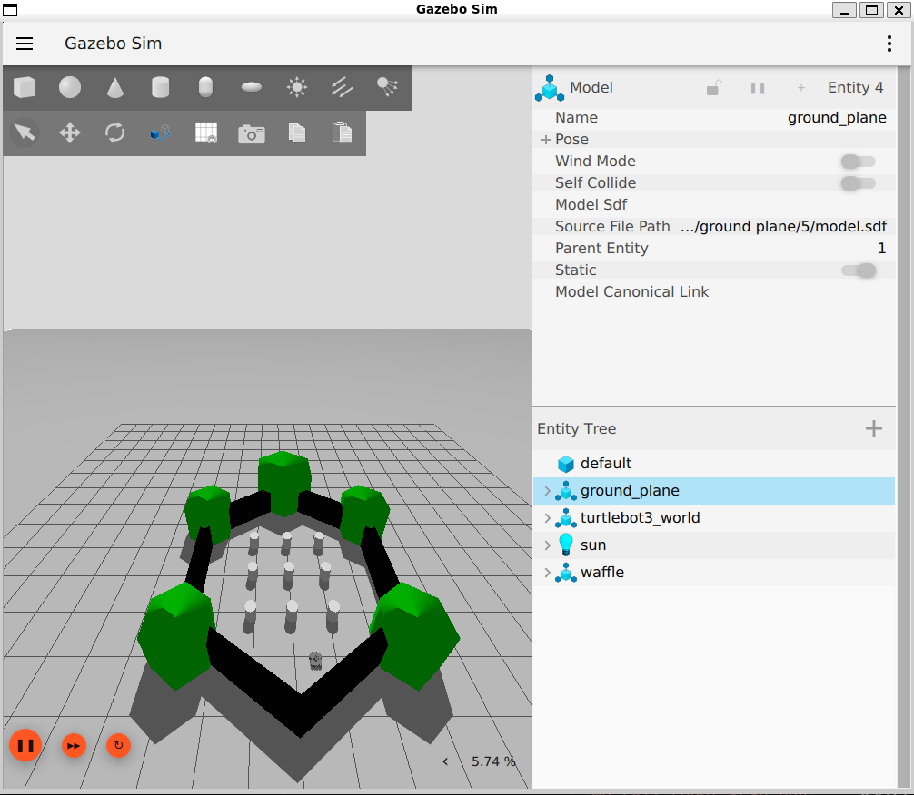 | 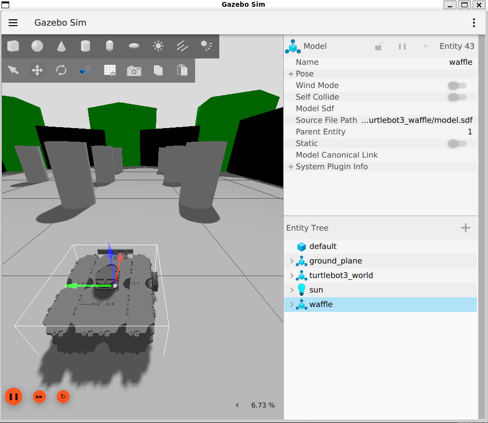 |

| Camera view | Side by side: Gazebo, camera, teleop |
|---|---|
| 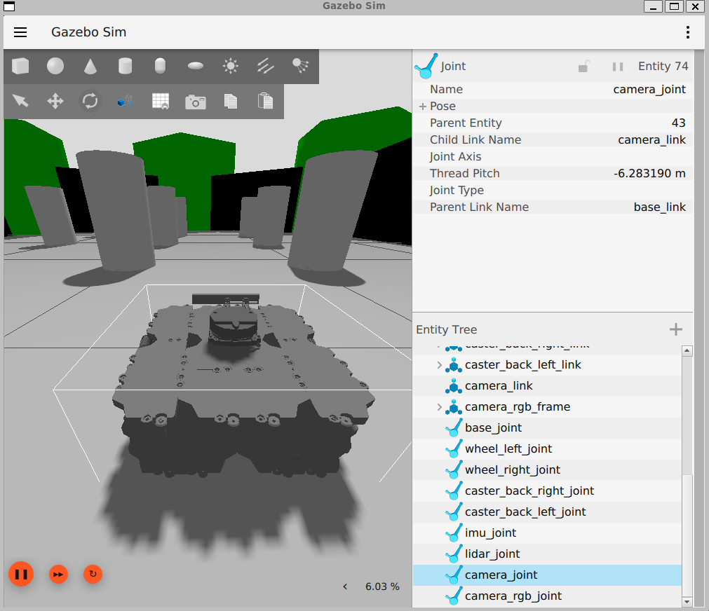 | 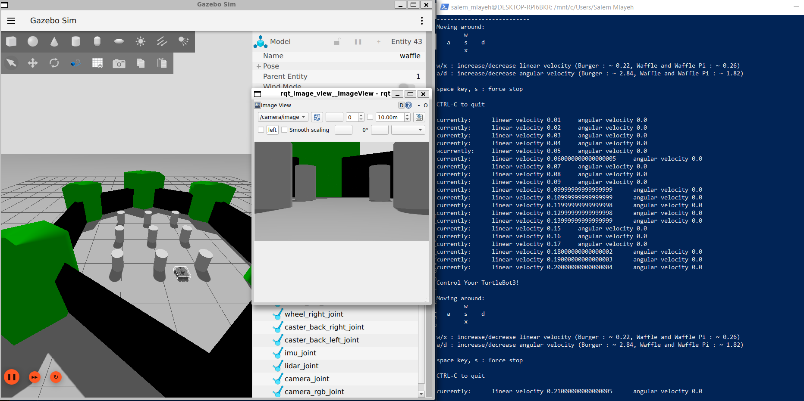 |

Topics published by the simulation, and the TF tree (`odom → base_footprint → base_link → sensors and wheels`):

| ROS 2 topics | TF tree |
|---|---|
| 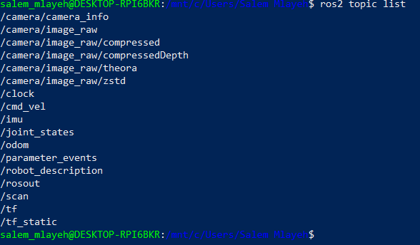 | 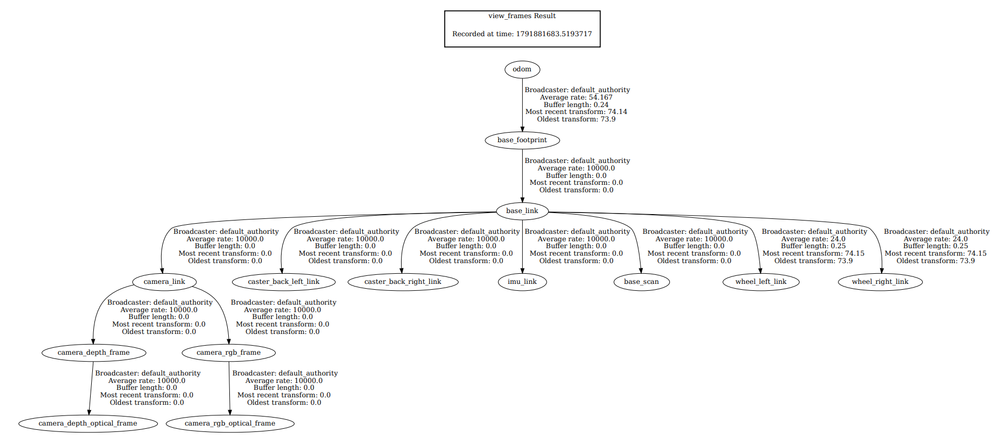 |

> The Waffle in this simulation has an RGB camera but **no depth topic**, so this repo does 2D lidar SLAM, not RGB-D SLAM.

## SLAM results

| Robot and live scan in RViz2 | Map being built |
|---|---|
| 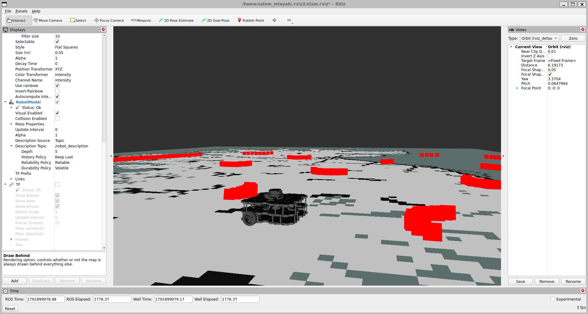 | 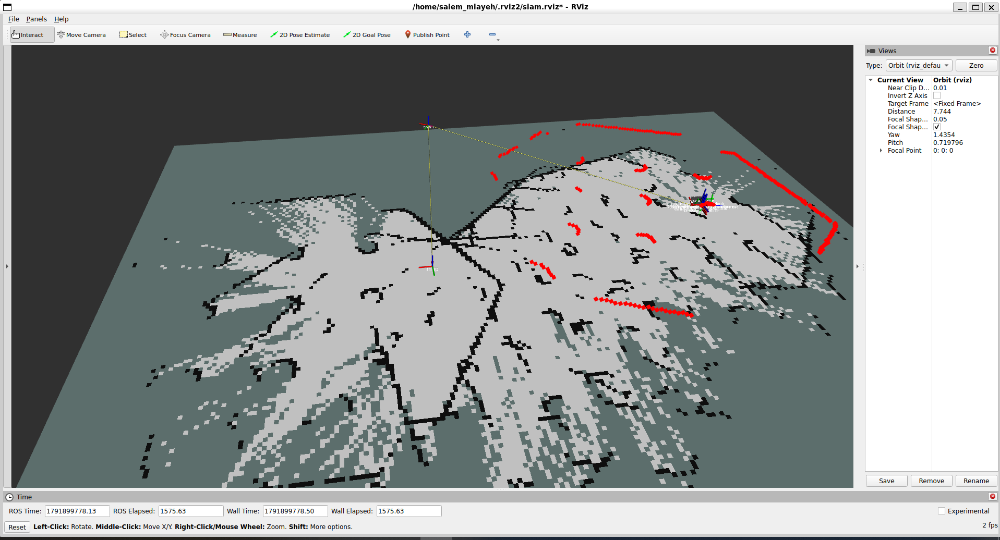 |

Final map:

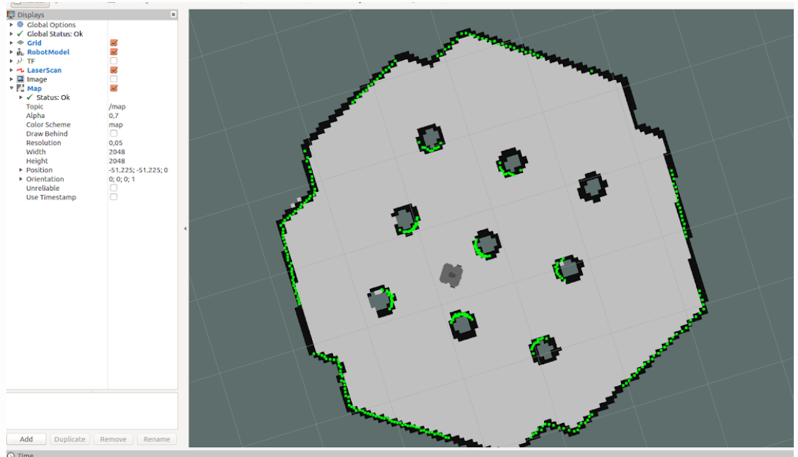

The saved map is in [`maps/`](maps/) (`world_map.pgm` and `world_map.yaml`).

## Installation

Tested on Ubuntu 24.04 with ROS 2 Jazzy installed from apt.

```bash
sudo apt install ros-jazzy-turtlebot3-gazebo ros-jazzy-turtlebot3-teleop \
  ros-jazzy-turtlebot3-navigation2 ros-jazzy-navigation2 ros-jazzy-nav2-bringup \
  ros-jazzy-slam-toolbox ros-jazzy-rqt-image-view

echo "export TURTLEBOT3_MODEL=waffle" >> ~/.bashrc
source ~/.bashrc
```

## Usage

Each command goes in its own terminal.

### 1. Simulation and mapping

```bash
# Terminal 1: Gazebo with the robot
ros2 launch turtlebot3_gazebo turtlebot3_world.launch.py

# Terminal 2: SLAM
ros2 launch slam_toolbox online_async_launch.py use_sim_time:=true

# Terminal 3: RViz2 with the saved layout
rviz2 -d rviz/slam.rviz

# Terminal 4: drive the robot slowly around the whole world
ros2 run turtlebot3_teleop teleop_keyboard
```

Save the map when it is closed and stable:

```bash
ros2 run nav2_map_server map_saver_cli -f maps/world_map
```

### 2. Navigation with Nav2

Stop SLAM and RViz2, keep Gazebo running, then:

```bash
ros2 launch turtlebot3_navigation2 navigation2.launch.py \
  use_sim_time:=True map:=$(pwd)/maps/world_map.yaml
```

In RViz2: set the robot's position with **2D Pose Estimate**, then give a destination with **Nav2 Goal**.

### 3. Automatic waypoints (C++)

[`nav_goals/src/waypoint_navigator.cpp`](nav_goals/src/waypoint_navigator.cpp) is an action client for Nav2's `NavigateToPose`. It reads a list of `(x, y, yaw)` waypoints from [`nav_goals/config/waypoints.yaml`](nav_goals/config/waypoints.yaml), sends them one at a time, logs the remaining distance, and stops if a goal is rejected, aborted, or canceled.

```bash
mkdir -p ~/ros2_ws/src
ln -s "$(pwd)/nav_goals" ~/ros2_ws/src/nav_goals
cd ~/ros2_ws
colcon build --packages-select nav_goals
source install/setup.bash

# With Gazebo and Nav2 already running and the initial pose set:
ros2 run nav_goals waypoint_navigator --ros-args \
  --params-file $(ros2 pkg prefix nav_goals)/share/nav_goals/config/waypoints.yaml \
  -p use_sim_time:=true
```

Edit the coordinates in `waypoints.yaml` to match free space on your own map.

## Results and limitations

<!-- Replace every [bracketed] item with what you actually observed. Delete this comment. -->

- Mapping run: about **[X] minutes** of slow manual driving to cover the whole world.
- Map quality: **[describe: sharp walls? doubled walls? small gaps behind the cylinders?]**.
- Navigation: **[describe: did the robot reach goals? how many attempts? what failed?]**.
- Limitations: the simulation world is small and simple; the map is 2D (lidar only); localisation depends on setting the initial pose by hand; fast turns during mapping reduce map quality.

## Next steps

These are planned, not done:

- RGB-D SLAM (for example RTAB-Map or ORB-SLAM3) evaluated on a public dataset such as TUM RGB-D, with trajectory error measured using `evo`.
- A launch file that starts the simulation, SLAM, and RViz2 together.
- Comparing Nav2 controller settings and reporting the differences.

## Repository structure

```
.
├── README.md
├── maps/                  # saved occupancy grid (world_map.pgm / .yaml)
├── rviz/                  # RViz2 configuration (slam.rviz)
├── screenshots/           # images and GIFs used in this README
└── nav_goals/             # ROS 2 C++ package (waypoint navigator)
    ├── CMakeLists.txt
    ├── package.xml
    ├── config/waypoints.yaml
    └── src/waypoint_navigator.cpp
```

## Credits

- [TurtleBot3](https://github.com/ROBOTIS-GIT/turtlebot3) by ROBOTIS (robot model and simulation world)
- [slam_toolbox](https://github.com/SteveMacenski/slam_toolbox) by Steve Macenski
- [Nav2](https://github.com/ros-navigation/navigation2)
- [Gazebo](https://gazebosim.org/) and [ros_gz](https://github.com/gazebosim/ros_gz)

## Author

Salem Amine Mlayeh, electrical and automation engineering student (ENIG, Tunisia). Interests: robot perception, SLAM, 3D vision.

## License

MIT (add a `LICENSE` file before publishing).
